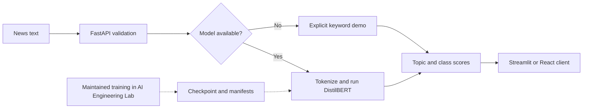

# NewsSnap: News Classification and Serving

NewsSnap classifies English news into **World, Sports, Business, and Sci/Tech**.
This repository preserves the original FastAPI service, Streamlit client, React
dashboard, and data-preparation code. The maintained training implementation is
in [AI Engineering Lab / NewsSnap](https://github.com/Zinga18018/ai-engineering-lab/tree/main/newssnap).

[Workflow and code walkthrough](WORKFLOW.md) ·
[Streamlit demo](https://yogesh-newssnap-classifier.streamlit.app/)

## What the project demonstrates

A news article enters a validated API, is tokenized and classified by a saved
DistilBERT checkpoint, and returns topic scores to the client. When model weights
are unavailable, the API explicitly reports demo mode and uses a keyword fallback.
Check the response mode before describing an output as a transformer prediction.
Softmax scores are not calibrated probabilities of correctness.

## Experiment evidence

The recovered records describe a historical February 2026 experiment. They do
not establish a newly reproduced or leakage-free result.

| Item | Recorded value |
| --- | ---: |
| Examples used to train the recovered checkpoint | **512** |
| Examples used for its validation | **128** |
| Epochs | **1** |
| Prepared training pool | 96,000 |
| Prepared validation pool | 12,000 |
| Project-created test split | 12,000 |
| Historical test accuracy | 0.8699 |
| Historical macro F1 | 0.8692 |

Evidence: [provenance](evidence/provenance.json),
[evaluation record](evidence/evaluation_results.json), and
[training history](evidence/training_history.json), copied without changing the
recorded measurements from the maintained project's recovered evidence.

The prepared splits were drawn from the upstream AG News **training split**;
the 12,000-example test is not the official AG News test split. The overlap audit
found 27 normalized texts shared between the prepared training pool and test
split. The original 512/128 sample IDs were not saved, so overlap in the fitted
subset is unknown. Do not claim that the model was trained on 96,000 examples.

The maintained implementation records sample IDs, split checks, and checkpoint
manifests for **new runs**. Those records do not reconstruct the missing history
of the original checkpoint.

## Architecture



## Run the serving application

```bash
pip install -r requirements-runtime.txt
python -m uvicorn src.serving.api:app --host 127.0.0.1 --port 8000
```

The React build requires Node 20.19+ or 22.12+, matching the [Vite requirements](https://vite.dev/guide/).

Without weights in `models/latest`, the service reports demo mode. Model weights
are not downloaded by these instructions. Start the React client separately:

```bash
cd dashboard
npm ci
npm run dev -- --host 127.0.0.1 --port 5173
```

The default Docker image starts the inference API and includes the recorded metric files. It does not run training. On a local clean clone, each metrics endpoint reads `models/latest` first and falls back to the corresponding tracked `evidence/` file when absent. The `X-Metrics-Source` response header identifies the source; neither location proves a fresh model run.

## Train a new model

Use the [maintained training guide](https://github.com/Zinga18018/ai-engineering-lab/tree/main/newssnap#local-development).
After cloning AI Engineering Lab:

```bash
cd ai-engineering-lab/newssnap
uv sync --group dev
uv run python -m src.models.train --help
```

Follow its data and run-size instructions before training. The legacy
`scripts/run_local_pipeline.py` and `scripts/trigger_training.py` now exit with
this migration guidance before changing data. Automatic SageMaker training on
pushes has been retired because this checkout does not contain that training
implementation. Terraform files remain historical optional infrastructure;
their presence is not evidence of a running deployment.

## Publish measured artifacts

The old publisher contained hand-written scores and training curves. It now
requires explicit local evaluation files and validates them before doing any
upload. For example, inspect the recovered historical records locally:

```bash
python scripts/run_pipeline.py --evaluation evidence/evaluation_results.json --training-history evidence/training_history.json
```

This default command makes no AWS requests. It prints file hashes and preserves
the supplied values. Actual uploads require `--upload --bucket YOUR_BUCKET`.
Schema validation and hashes identify files; they cannot establish that a model
experiment was performed correctly. No cloud upload was needed for this repair.

## Quality checks

```bash
pip install -r requirements-test.txt
python -m pytest tests -q
cd dashboard
npm test
npm run build
```

The Python suite passed **41 tests** locally on September 14, 2026 (Python 3.14).
Tests cover preprocessing, API/demo behavior, input/output parsing, migration, and
publication contracts; they do not run a transformer inference or training job.
Model dependencies load only when model operations are requested.
The migration tests require neither model downloads nor AWS. The updated client
passed 15 client tests and a Vite 8 production build; the September 14 npm audit
reported 0 known vulnerabilities in the resolved dependency tree. This is a dated
dependency check, not a security guarantee. A large-bundle warning remains.
CI validates the Python code, clients, and serving image; consult the actual
workflow result for the current commit.

## Interview explanation

“I built a news-classification service and audited its recovered model records.
The saved checkpoint used 512 training examples from a larger prepared pool.
I made the incomplete history explicit, removed example scores from the
publishing path, and moved new experiments to a workflow that records sample IDs
and model artifacts. The public demo distinguishes model inference from fallback
behavior.”

## Limitations

The recovered experiment is small and has unresolved split-overlap history.
Current-headline, multilingual, calibration, and out-of-domain evaluations are
not recorded here. Deployment configurations and demo links do not prove current
uptime or production reliability.
