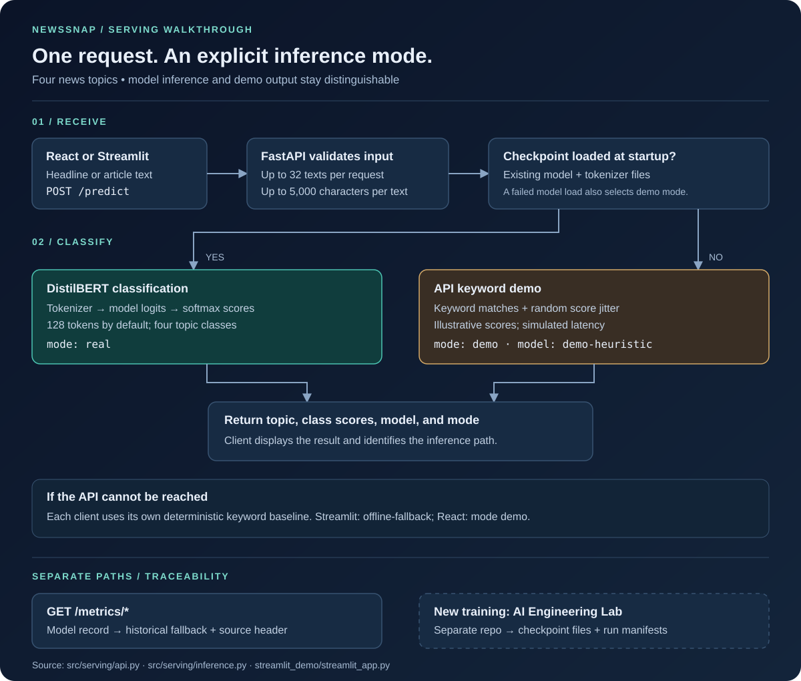
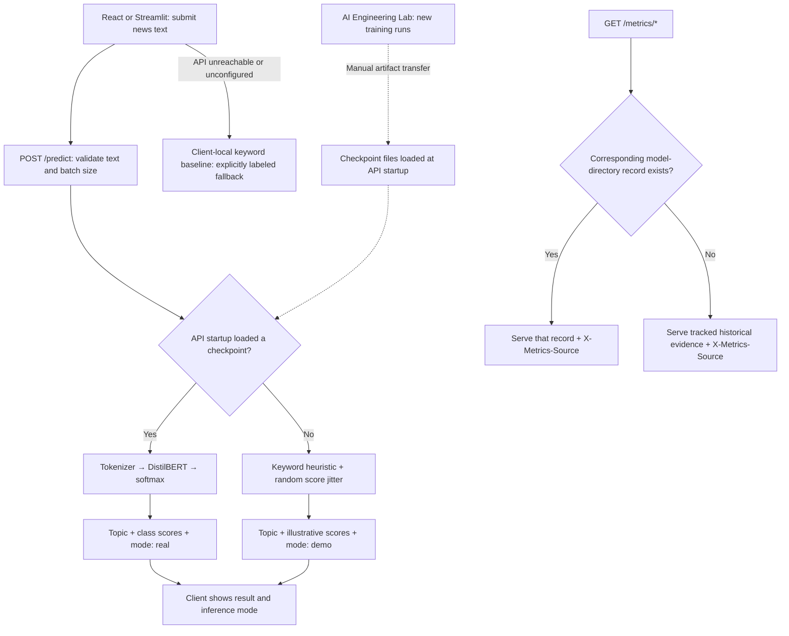

# NewsSnap · news topic classification

Send an English headline or article to the API and get one of four topics:
**World, Sports, Business, or Sci/Tech**. This repository contains the FastAPI
service, React dashboard, Streamlit demo, and original data-preparation code.
New model experiments live in
[AI Engineering Lab / NewsSnap](https://github.com/Zinga18018/ai-engineering-lab/tree/main/newssnap).

[Workflow and code walkthrough](WORKFLOW.md) ·
[Streamlit demo](https://yogesh-newssnap-classifier.streamlit.app/)

For a quick review, follow [one request through the code](#architecture),
[run the API locally](#run-the-serving-application), then read the
[experiment evidence](#experiment-evidence) before interpreting the scores.

## What the project demonstrates

A news article enters a validated API, is tokenized and classified by a saved
DistilBERT checkpoint, and returns topic scores to the client. When model weights
are unavailable, the API explicitly reports demo mode and uses a keyword fallback.
The response carries `mode: "real"` for a loaded model or `mode: "demo"` for
the API's keyword heuristic. The Streamlit client has a deterministic
`offline-fallback` if it cannot reach the API. The React client uses a separate
deterministic browser baseline (`transparent-browser-fallback`, `mode: "demo"`)
when its API is unavailable or unconfigured. API demo scores include random
jitter and its displayed latency is simulated. Check the mode before interpreting
an output; demo scores are illustrative and model softmax scores are not
calibrated probabilities of correctness.

## Experiment evidence

The recovered records describe a historical February 2026 experiment. They do
not establish a newly reproduced or leakage-free result.

| Item | Recorded value |
| --- | ---: |
| Examples used to train the recovered checkpoint | **512** |
| Examples used for its validation | **128** |
| Epochs | **1** |
| Prepared training pool | 96,000 |
| Prepared validation pool | 12,000 |
| Project-created test split | 12,000 |
| Historical test accuracy | 0.8699 |
| Historical macro F1 | 0.8692 |

Evidence: [provenance](evidence/provenance.json),
[evaluation record](evidence/evaluation_results.json), and
[training history](evidence/training_history.json), copied without changing the
recorded measurements from the maintained project's recovered evidence.

The prepared splits were drawn from the upstream AG News **training split**;
the 12,000-example test is not the official AG News test split. The overlap audit
found 27 normalized texts shared between the prepared training pool and test
split. The original 512/128 sample IDs were not saved, so overlap in the fitted
subset is unknown. Do not claim that the model was trained on 96,000 examples.

The maintained implementation records sample IDs, split checks, and checkpoint
manifests for **new runs**. Those records do not reconstruct the missing history
of the original checkpoint.

## Architecture



The diagram follows the serving path in this repository. The dashed training
link points to a separate repository; it is not a training stage run by this API.



| Step | Implementation | Why it matters |
| --- | --- | --- |
| Request validation | [`PredictRequest` and `/predict`](src/serving/api.py), [`validate_text`](src/utils/validation.py) | Limits requests to 32 texts and 5,000 characters per text. |
| Model inference | [`model_fn` / `predict_fn`](src/serving/inference.py) | Loads local checkpoint files; pads/truncates to 128 tokens by default and returns four class scores. |
| Missing weights | [`_load_model` / `_demo_predict`](src/serving/api.py) | Keeps the UI usable while explicitly reporting a heuristic result. |
| API unavailable | [Streamlit fallback](streamlit_demo/streamlit_app.py), [React fallback](dashboard/src/demoClassifier.js), [client handling](dashboard/src/components/TestModelPage.jsx) | Each client has its own deterministic keyword baseline and identifies the fallback. |
| Evidence source | [`_metrics_source`](src/serving/api.py) | Identifies model-directory versus historical files without implying a fresh experiment. |

## Key decisions

- **Expose the inference mode.** Missing weights and an unavailable API are
  different states. Their fallback paths are visible so a working demo cannot be
  mistaken for verified transformer inference.
- **Keep new training separate.** The legacy training commands stop with migration
  instructions. The maintained project records sample IDs and manifests for new
  experiments; those records cannot repair the recovered checkpoint's history.
- **Publish supplied records, not example metrics.** The publisher validates local
  evaluation files and hashes them before any explicitly requested upload.

## Run the serving application

Use Python 3.11 (the CI version) in an activated virtual environment. From the
repository root:

```bash
python -m pip install -r requirements-runtime.txt
python -m uvicorn src.serving.api:app --host 127.0.0.1 --port 8000
```

The React build requires Node 20.19+ or 22.12+, matching the [Vite requirements](https://vite.dev/guide/).

Open `http://127.0.0.1:8000/docs`. Call `GET /health` to see the current mode,
then try `POST /predict` with this synthetic example:

```json
{"text": "The team won the championship after scoring twice in the final match."}
```

The response includes `label`, `probabilities`, `model`, and `mode`. On a clean
clone with no checkpoint or S3 configuration, expect `demo` / `demo-heuristic`.
`MODEL_DIR` can point to an existing checkpoint. An optional `S3_BUCKET_MODELS`
setting activates a download attempt at startup; no S3 setting is needed for
the local demo.

Without usable weights in `models/latest`, the service reports demo mode.
Start the React client separately:

```bash
cd dashboard
npm ci
npm run dev -- --host 127.0.0.1 --port 5173
```

The default Docker image starts the inference API and includes the recorded metric files. It does not run training. On a local clean clone, each metrics endpoint reads `models/latest` first and falls back to the corresponding tracked `evidence/` file when absent. The `X-Metrics-Source` response header identifies the source; neither location proves a fresh model run.

## Train a new model

Use the [maintained training guide](https://github.com/Zinga18018/ai-engineering-lab/tree/main/newssnap#local-development).
After cloning AI Engineering Lab:

```bash
cd ai-engineering-lab/newssnap
uv sync --group dev
uv run python -m src.models.train --help
```

Follow its data and run-size instructions before training. The legacy
`scripts/run_local_pipeline.py` and `scripts/trigger_training.py` now exit with
this migration guidance before changing data. Automatic SageMaker training on
pushes has been retired because this checkout does not contain that training
implementation. Terraform files remain historical optional infrastructure;
their presence is not evidence of a running deployment.

## Publish measured artifacts

The old publisher contained hand-written scores and training curves. It now
requires explicit local evaluation files and validates them before doing any
upload. For example, inspect the recovered historical records locally:

```bash
python scripts/run_pipeline.py --evaluation evidence/evaluation_results.json --training-history evidence/training_history.json
```

This default command makes no AWS requests. It prints file hashes and preserves
the supplied values. Actual uploads require `--upload --bucket YOUR_BUCKET`.
Schema validation and hashes identify files; they cannot establish that a model
experiment was performed correctly. No cloud upload was needed for this repair.

## Quality checks

```bash
python -m pip install -r requirements-test.txt
python -m pytest tests -q
cd dashboard
npm test
npm run build
```

The Python suite passed **41 tests** locally on September 14, 2026 (Python 3.14).
Tests cover preprocessing, API/demo behavior, input/output parsing, migration, and
publication contracts; they do not run a transformer inference or training job.
Model dependencies load only when model operations are requested.
The migration tests require neither model downloads nor AWS. The updated client
passed 15 client tests and a Vite 8 production build; the September 14 npm audit
reported 0 known vulnerabilities in the resolved dependency tree. This is a dated
dependency check, not a security guarantee. A large-bundle warning remains.
CI validates the Python code, clients, and serving image; consult the actual
workflow result for the current commit.

## A concise walkthrough

The service validates a news snippet, selects the loaded-model or keyword-demo
path, and returns the topic with its inference mode. Its recovered checkpoint
records 512 training examples from a larger prepared pool. The evidence audit
documents the missing sample IDs and split overlap. New training runs use the
maintained project so sample IDs and model artifacts can be traced from the start.

## Limitations

The recovered experiment is small and has unresolved split-overlap history.
Current-headline, multilingual, calibration, and out-of-domain evaluations are
not recorded here. Deployment configurations and demo links do not prove current
uptime or production reliability.
