# NewsSnap: Transformer News Classification

NewsSnap classifies AG News articles into `World`, `Sports`, `Business`, or
`Sci/Tech`. The repository contains a reproducible DistilBERT training pipeline,
saved evaluation artifacts, a FastAPI inference service, and two clients: a
small Streamlit demo and a React diagnostics dashboard.

## Project story

### What is the project about?

NewsSnap turns raw news text into one of four useful categories: World, Sports,
Business, or Sci/Tech. It covers the full path from preparing the data and
training a transformer to serving predictions through an API and displaying
them in a web interface.

### What was the thought process?

The project was built in four layers: create fixed train, validation, and test
datasets; fine-tune a compact transformer; expose the saved model through a
validated API; then build a simple interface that shows the class and confidence.
Tests and deployment files were added so the result was more than a notebook.

### Why use this approach?

DistilBERT understands word context better than a basic keyword counter while
being smaller than full BERT. FastAPI keeps model inference separate from the
user interface, which makes the system easier to test and replace. The demo also
labels its fallback mode clearly so a keyword result is never presented as a
real transformer prediction.

### How does it work?

```text
AG News articles
  -> fixed train, validation, and test files
  -> DistilBERT tokenization and fine-tuning
  -> saved model and evaluation artifacts
  -> FastAPI prediction endpoint
  -> Streamlit classifier or React diagnostics dashboard
```

### How to explain it in 30 seconds

I built NewsSnap to practice the complete NLP product workflow. I fine-tuned
DistilBERT to classify news into four categories, evaluated it on a separate
12,000-article test set, and wrapped the saved model in a FastAPI service. I then
built Streamlit and React interfaces and added tests and deployment workflows.
The public demo clearly says when it is using a lightweight fallback instead of
the trained model.

## Demo

[Open the Streamlit classifier](https://yogesh-newssnap-classifier.streamlit.app/)

The demo states whether a result came from the trained model API or the
deterministic keyword fallback. The fallback is never reported as DistilBERT.
The Render API can take time to wake after inactivity.

## Highlights
- Local pipeline: ingestion -> preprocessing -> training -> evaluation.
- DistilBERT text classifier with reproducible configuration (`config.py`).
- FastAPI inference with schema validation and request throttling.
- Streamlit classifier plus a React diagnostics dashboard.
- Dashboard requests have cancellation, a bounded timeout, and response-shape
  validation so a sleeping backend cannot leave the interface stuck.
- CI/CD workflows for quality checks, ML pipeline, and Terraform automation.

## Product Showcase

<p align="center">
  <a href="Images/insights-overview.png">
    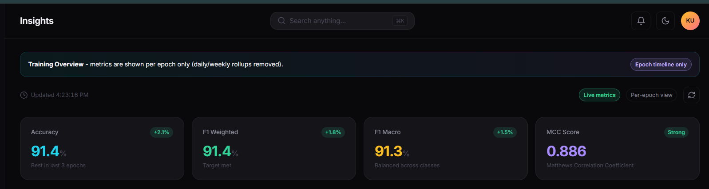
  </a>
</p>

<p align="center"><strong>Insights Dashboard:</strong> epoch-focused metrics, live/demo status, and clean operational telemetry.</p>

| Training Intelligence | Model Testing |
|---|---|
| <a href="Images/training-charts.png">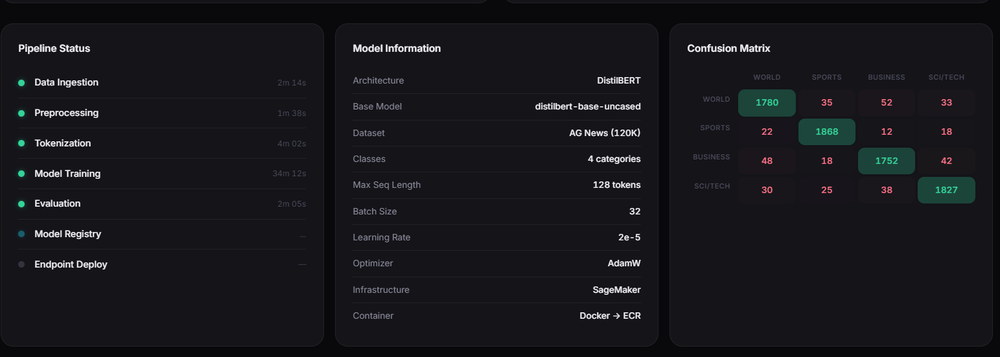</a><br/><sub>Loss convergence + PR curve view</sub> | <a href="Images/test-model-input.png">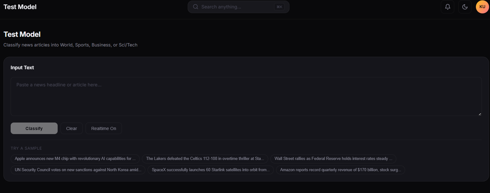</a><br/><sub>Interactive headline classification UX</sub> |
| <a href="Images/pipeline-confusion-matrix.png">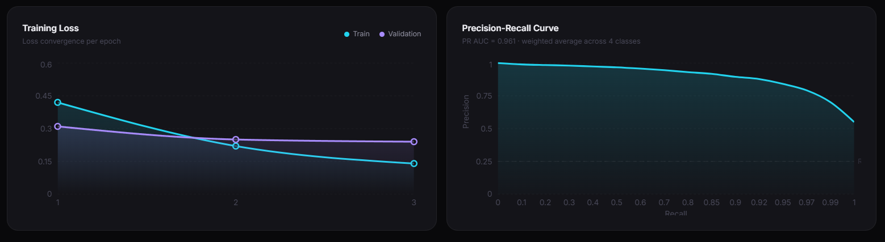</a><br/><sub>Pipeline health + confusion matrix diagnostics</sub> | <a href="Images/data-pipeline-overview.png">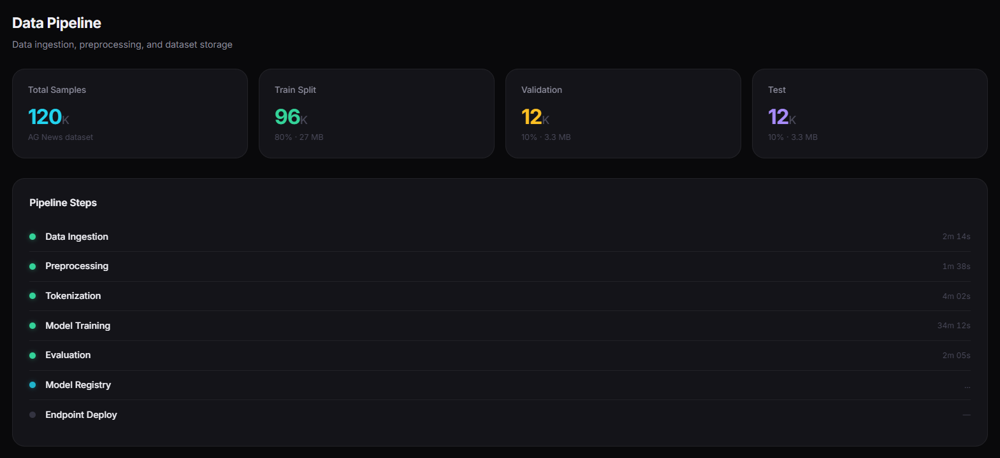</a><br/><sub>Dataset split and processing timeline</sub> |

| Infrastructure Views | Delivery & Ops |
|---|---|
| <a href="Images/endpoints-overview.png">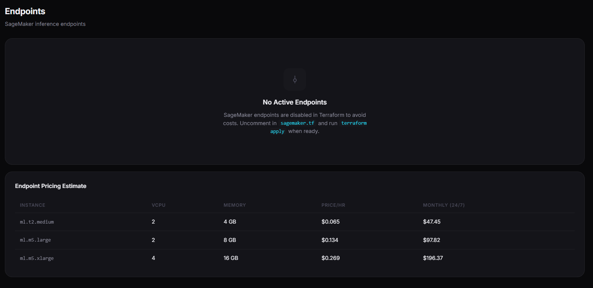</a><br/><sub>Endpoint readiness and cost estimates</sub> | <a href="Images/provisioned-resources.png">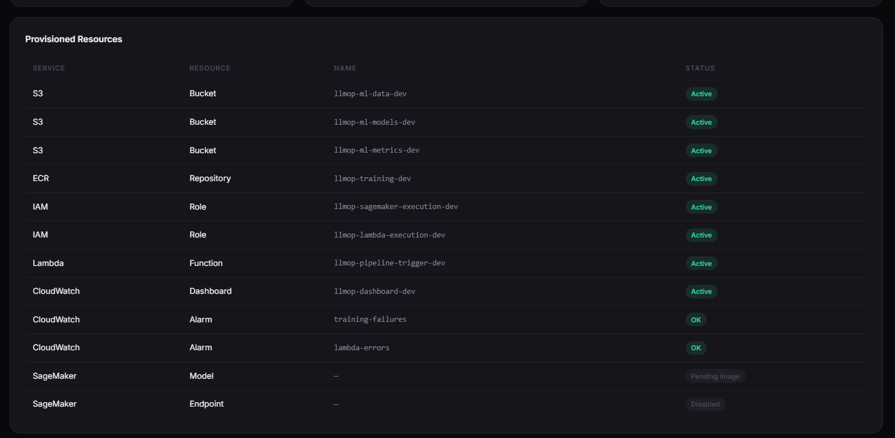</a><br/><sub>AWS resource inventory and status</sub> |
| <a href="Images/s3-storage-table.png">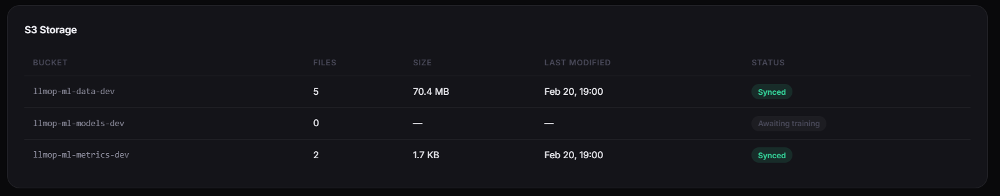</a><br/><sub>Storage state across data/model/metrics buckets</sub> | <a href="Images/settings-cicd.png">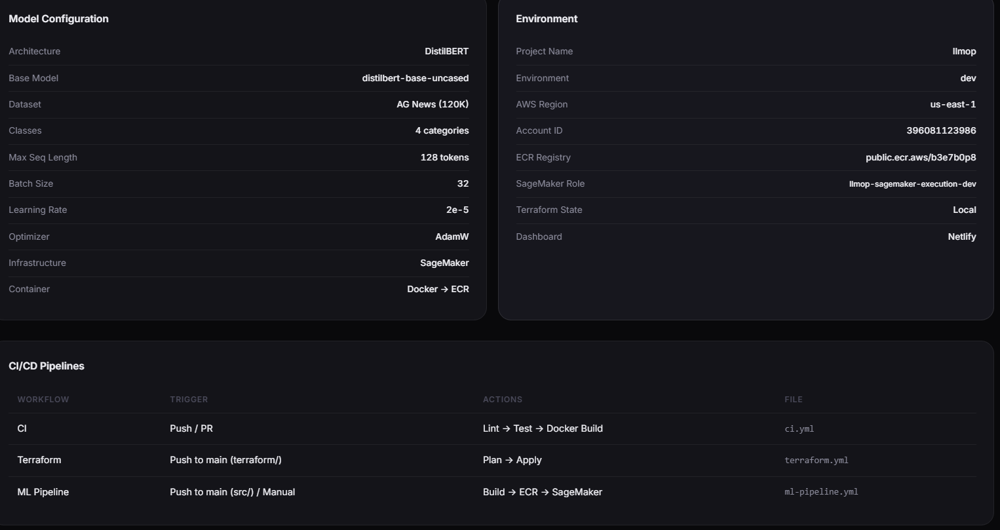</a><br/><sub>Environment, model config, and pipeline wiring</sub> |

## Measured Results
### Evaluation Snapshot
Source: `models/latest/evaluation_results.json` (timestamp `2026-02-21T04:29:44.346151`)

| Metric | Value |
|---|---:|
| Accuracy | 0.8699 |
| F1 (Weighted) | 0.8692 |
| F1 (Macro) | 0.8692 |
| MCC | 0.8270 |
| Test Samples | 12,000 |

### Class-wise Metrics
| Class | Precision | Recall | F1 | Support |
|---|---:|---:|---:|---:|
| World | 0.8292 | 0.8983 | 0.8624 | 3000 |
| Sports | 0.9482 | 0.9697 | 0.9588 | 3000 |
| Business | 0.8606 | 0.7963 | 0.8272 | 3000 |
| Sci/Tech | 0.8417 | 0.8153 | 0.8283 | 3000 |

### Training Snapshot
Source: `models/latest/training_history.json`

| Epoch | Train Loss | Train Acc | Val Loss | Val Acc | Val F1 |
|---:|---:|---:|---:|---:|---:|
| 1 | 1.1816 | 0.6582 | 0.9204 | 0.9141 | 0.9135 |

### Dataset and Artifact Footprint
| Item | Value |
|---|---:|
| Train split (`data/processed/train.jsonl`) | 96,000 |
| Validation split (`data/processed/val.jsonl`) | 12,000 |
| Test split (`data/processed/test.jsonl`) | 12,000 |
| Model artifact (`models/latest/model.safetensors`) | 267,838,720 bytes (~255.4 MB) |

## System Architecture
### End-to-End Flow
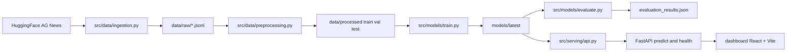

### Runtime Inference Path
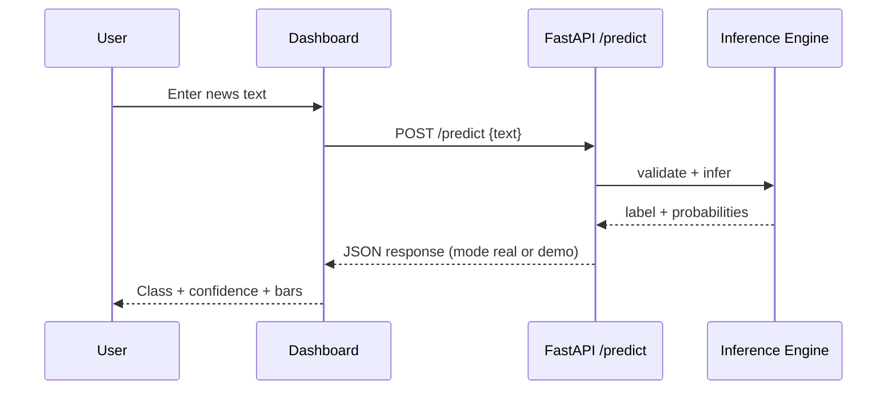

### DevOps Workflow Topology
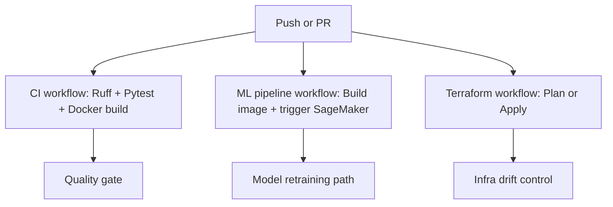

## Repository Layout
```text
.
|- src/
|  |- data/            # ingestion + preprocessing
|  |- models/          # training + evaluation
|  |- serving/         # FastAPI service + inference handlers
|  |- utils/           # logging, validation, rate limiting
|- scripts/
|  |- run_local_pipeline.py
|- dashboard/          # React + Vite UI
|- tests/              # unit + API behavior tests
|- terraform/          # optional cloud infrastructure
|- models/latest/      # local trained artifacts + metrics
|- .github/workflows/  # CI, ML pipeline, Terraform automation
```

## Quick Start (Local First)
### 1) Install dependencies
```bash
pip install -r requirements.txt
cd dashboard && npm install && cd ..
```

### 2) Run complete local pipeline
Fast local run (subsampled):
```bash
py scripts/run_local_pipeline.py
```

Full-data run:
```bash
py scripts/run_local_pipeline.py --max-train-samples 0 --max-val-samples 0 --epochs 3 --batch-size 32
```

### 3) Start API
```bash
py -m uvicorn src.serving.api:app --host 127.0.0.1 --port 8000
```

Health check:
```bash
curl http://127.0.0.1:8000/health
```

### 4) Start dashboard
```bash
cd dashboard
npm run dev -- --host 127.0.0.1 --port 5173
```
Open `http://127.0.0.1:5173`.

## API Contract
### `POST /predict`
Request:
```json
{
  "text": "Apple announces new AI chip for laptops"
}
```

Response (shape):
```json
{
  "predictions": [
    {
      "text": "...",
      "label": "Sci/Tech",
      "confidence": 0.91,
      "probabilities": {
        "World": 0.02,
        "Sports": 0.01,
        "Business": 0.06,
        "Sci/Tech": 0.91
      },
      "model": "distilbert-base-uncased",
      "latency_ms": 12.3
    }
  ],
  "mode": "real",
  "model_dir": "models/latest"
}
```

## Why You May See Demo Mode
`Demo Mode` on the Test Model page means the backend could not load `models/latest` model weights and fell back to the built-in heuristic classifier.

Common reasons:
- Free/cloud deployment does not include the large model artifact (`model.safetensors`).
- The backend has no S3 model download configuration.
- The model failed to load due memory/startup constraints.

How to verify:
```bash
curl https://<your-app>/health
```
If it returns `"mode":"demo"`, inference is fallback mode.

### Run Real Inference Locally (Free)
If your local `models/latest/` folder exists, the same app can run real inference from your laptop:
```bash
npm run build --prefix dashboard
py -m uvicorn src.serving.api:app --host 0.0.0.0 --port 8000
curl http://127.0.0.1:8000/health
```
Expected: `"mode":"real"`

### Metrics Endpoints (actual saved metrics)
The backend exposes saved experiment metrics (if present):
- `GET /metrics/latest_evaluation.json`
- `GET /metrics/latest_metrics.json`

The dashboard reads these endpoints by default and falls back to demo metrics only if they are unavailable.

## Testing and Quality
Run the Python suite:
```bash
py -m pytest -q
```

Run the dashboard API-client tests and production build:

```bash
cd dashboard
npm test
npm run build
```

Verification for the current dashboard client: `5` API-client tests pass and
the Vite production build completes. The build reports a non-blocking bundle
size warning for the existing dashboard (`572.76 kB` minified JavaScript).

## Deployment notes

- `streamlit_demo/` is the public demo and is deployed on Streamlit Community
  Cloud.
- `render.yaml` and `Dockerfile.render` describe the hosted FastAPI service.
- `Dockerfile.space` supports an optional Hugging Face Space.
- `terraform/` contains the optional AWS training path; local training does not
  require AWS.

If a deployed backend does not contain `models/latest`, the API reports
`"mode":"demo"`. Check `/health` before presenting a hosted prediction as model
inference. `VITE_API_URL`, when used, must be the backend base URL and must not
end in `/predict`.

## Reproducibility Notes
- Default label mapping is fixed (`World`, `Sports`, `Business`, `Sci/Tech`).
- Split generation uses stratification and deterministic random seed defaults.
- Training/evaluation artifacts are stored under `models/latest/`.
- Configuration is centralized in `config.py` with environment variable overrides.

## Optional AWS Path
AWS resources (S3, SageMaker, Terraform) are optional.
You can run training, evaluation, API, and dashboard fully local without cloud spend.

## Acknowledgments
- AG News dataset (HuggingFace Datasets)
- HuggingFace Transformers
- FastAPI and React ecosystem
