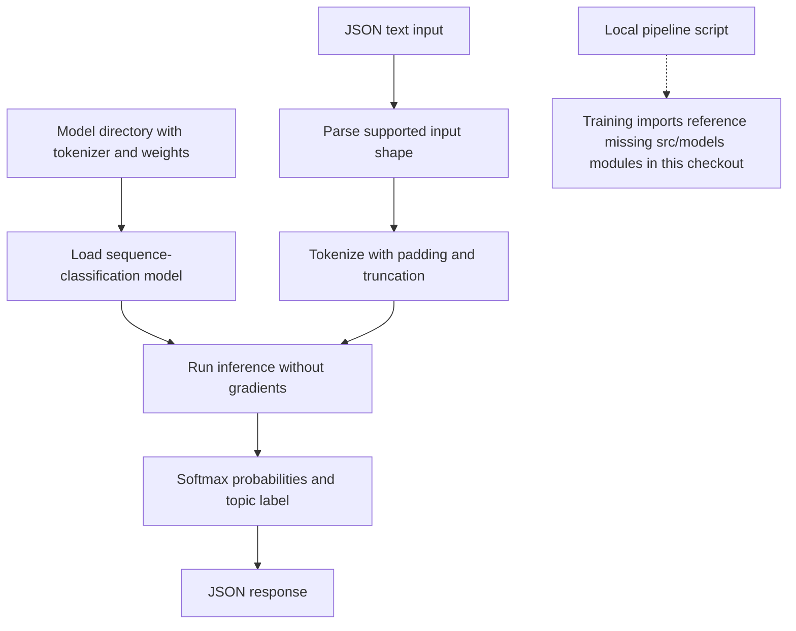

# NewsSnap Legacy Serving Repository: workflow

The serving module loads a sequence-classification model, tokenizes incoming news text and returns four-topic probabilities. The consolidated AI Engineering Lab contains the newer provenance and training workflow.

**Relevant roles:** ML engineering foundations.

## Flowchart

## Explain it in an interview

“The implemented serving path is clear, but this older repository needs reconciliation with the consolidated project before I present it as reproducible end to end.”

## What this diagram does and does not establish

The local pipeline references src.models.train and src.models.evaluate, which are absent from this checkout. Treat its end-to-end training instructions as incomplete. Use the [consolidated NewsSnap workflow](https://github.com/Zinga18018/ai-engineering-lab/tree/main/newssnap) for the recovered checkpoint provenance and newer implementation; this chart does not verify a running cloud deployment.

## Follow the code

- [Implemented inference handlers](src/serving/inference.py)
- [Local pipeline entry point](scripts/run_local_pipeline.py)
- [Data preparation](src/data/preprocessing.py)
