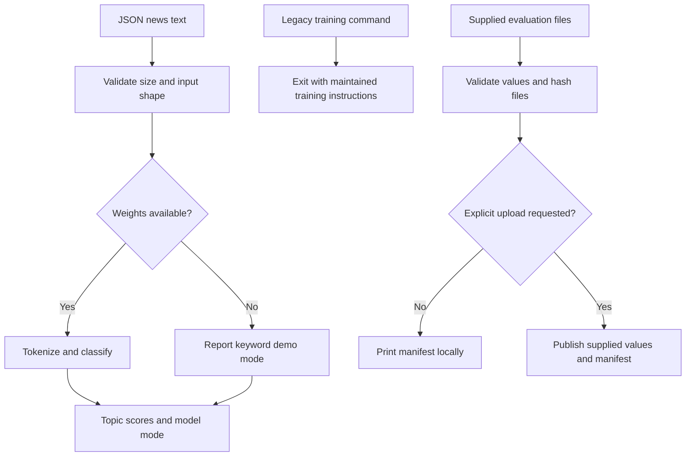

# NewsSnap legacy serving workflow

The API loads an available sequence-classification checkpoint and returns four
topic scores. When weights are absent, it explicitly identifies keyword demo
mode. New training belongs to the maintained AI Engineering Lab project.

## Follow the implementation

- [API and explicit inference mode](src/serving/api.py)
- [Inference handlers](src/serving/inference.py)
- [Training migration entry point](scripts/run_local_pipeline.py)
- [Measured-file publisher](scripts/run_pipeline.py)
- [Publication regression tests](tests/test_artifact_publication.py)
- [Checkpoint provenance and limitations](evidence/provenance.json)
- [Maintained training implementation](https://github.com/Zinga18018/ai-engineering-lab/tree/main/newssnap)

## What this establishes

The legacy scripts no longer reference absent training modules or fabricate
evaluation scores. The recovered checkpoint records **512 training examples**,
not the prepared 96,000-example pool. Its original sampled IDs are missing.
File hashes support traceability, not independent proof of training. No cloud
deployment or fresh model-quality evaluation is established by this diagram.
